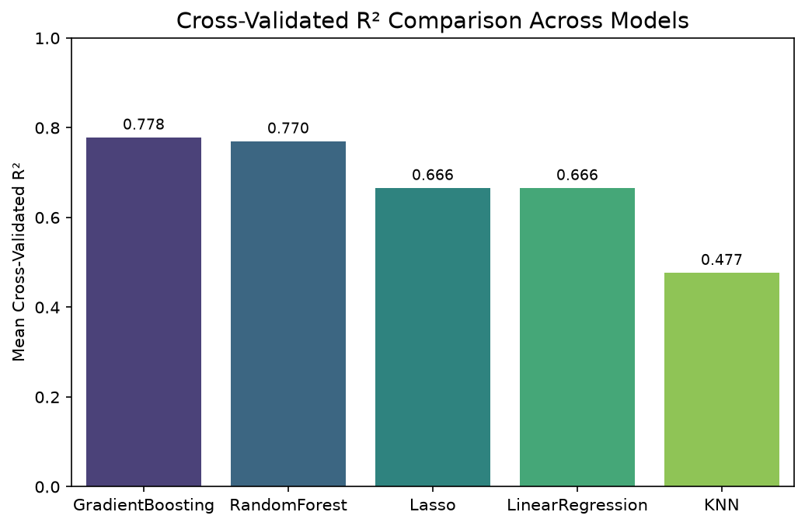
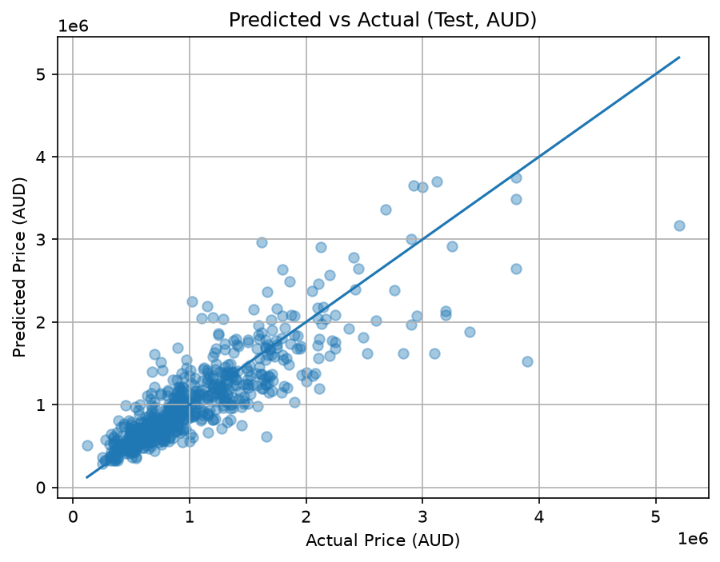
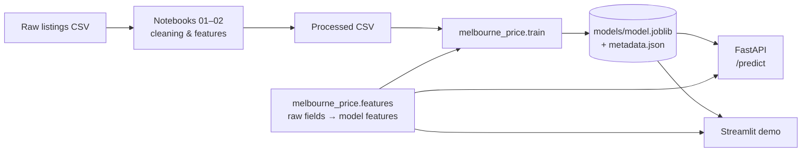

# 🏠 Melbourne House Price Prediction

[](https://github.com/meganekarol/machine-learning-melbourne-price-prediction/actions/workflows/ci.yml)


An end-to-end machine learning project that predicts the sale price of residential properties in
Melbourne, Australia. It covers data cleaning, feature engineering, model selection, evaluation,
and deployment as a REST API and an interactive web app.

**▶ [Try the live demo](https://melbourne-house-price.streamlit.app)**: pick a suburb, describe a property, get a price estimate.

<!-- Replace with a screenshot of the deployed demo: docs/images/demo.png -->

## Results

The final model is a tuned **Gradient Boosting Regressor**, trained on log-transformed price.

| Metric (hold-out test set, 779 sales) | Value |
|---|---|
| R² (log price) | **0.779** |
| R² (price, AUD) | 0.739 |
| Mean absolute error | **A$186k** (median sale price A$860k) |
| 5-fold CV R² (log price) | 0.781 ± 0.025 |

| Model comparison (5-fold CV) | Predicted vs actual (test set) |
|---|---|
|  |  |

**What drives price?** Location and size dominate: being in the Southern Metropolitan region,
building area, and distance to the CBD are the three most important features
([feature importance plot](docs/images/feature_importance.png)).

## Approach

| Step | Notebook | Highlights |
|---|---|---|
| 1. Exploration & cleaning | [01_DataExploration](notebooks/01_DataExploration.ipynb) | 60% missing building area, 55% missing year built. Imputed per property type; price is heavily skewed, so the model is trained on log price |
| 2. Feature engineering & pipeline | [02_PreprocessingPipeline](notebooks/02_PreprocessingPipeline.ipynb) | `PropertyAge`, `Log_TotalArea`, `Is_CBD`; frequency encoding for 295 suburbs, one-hot for low-cardinality columns; custom scikit-learn transformers; feature-selection comparison |
| 3. Model selection | [03_ModelSelection](notebooks/03_ModelSelection.ipynb) | 5 models × grid search with preprocessing **inside** each CV fold (no leakage). Gradient Boosting 0.778 vs Random Forest 0.770 vs Linear 0.666 |
| 4. Evaluation | [04_EvaluationAnalysis](notebooks/04_EvaluationAnalysis.ipynb) | Hold-out test, residual diagnostics, feature importance, where the model struggles (homes above A$2M) |

## Architecture



Training and inference share the same feature-engineering code (`src/melbourne_price/features.py`),
and a test checks that it reproduces the training dataset exactly, so there is no training/serving skew.

## Quickstart

```bash
git clone https://github.com/meganekarol/machine-learning-melbourne-price-prediction.git
cd machine-learning-melbourne-price-prediction
python -m venv .venv
.venv\Scripts\activate              # macOS/Linux: source .venv/bin/activate
pip install -e ".[api,dev]"

pytest                              # run the test suite
python -m melbourne_price.train     # retrain → models/ (≈15 s)
streamlit run demo/app.py           # web demo at http://localhost:8501
uvicorn api.main:app --reload       # API + interactive docs at http://127.0.0.1:8000/docs
```

Or run the API with Docker:

```bash
docker build -t melbourne-price-api .
docker run -p 8000:8000 melbourne-price-api
```

### API example

```bash
curl -X POST http://127.0.0.1:8000/predict_one -H "Content-Type: application/json" -d '{
  "suburb": "Northcote", "property_type": "h", "region": "Northern Metropolitan",
  "council_area": "Darebin City Council", "distance_km": 5.3, "bedrooms": 3,
  "bathrooms": 1, "car_spaces": 2, "land_size_m2": 515, "building_area_m2": 148,
  "year_built": 1960, "latitude": -37.8065, "longitude": 144.9927
}'
```

```json
{"predictions": [{"price_aud": 1200375.48}], "currency": "AUD", "model_version": "2.0.0"}
```

Endpoints: `GET /health`, `GET /version` (model metrics), `POST /predict_one`, `POST /predict` (batch of up to 1,000).
Inputs are validated (e.g. property type must be `h`, `u` or `t`), and invalid requests return `422` with details.

## Project structure

```
├── notebooks/              # 01 EDA & cleaning → 02 features → 03 model selection → 04 evaluation
├── src/melbourne_price/
│   ├── features.py         # raw listing fields → model features (shared by training & serving)
│   ├── transformers.py     # custom scikit-learn transformers (FrequencyEncoder, DataFrameImputer)
│   ├── pipeline.py         # preprocessing + model pipeline, tuned hyperparameters
│   ├── train.py            # reproducible training & evaluation
│   └── predict.py          # model loading & prediction
├── api/main.py             # FastAPI service
├── demo/app.py             # Streamlit web app
├── models/                 # trained model + metadata (metrics, params, versions)
├── data/                   # raw & processed data (see data/README.md)
├── tests/                  # feature, model, API and demo tests
├── Dockerfile
└── .github/workflows/ci.yml  # lint + tests + Docker build on every push
```

## Limitations & next steps

- **Small training set.** The course analysis used a random sample of 5,000 of the 34,857 listings
  (3,895 with a price). Training on all priced listings is the most promising improvement.
- **Imputed coordinates.** 22% of sales had missing latitude/longitude, filled with a single
  city-wide mean during cleaning. Imputing from each suburb's location would make the location features more accurate.
- **Expensive homes.** Errors grow above ~A$2M, where there are few training examples.
- **Prices from 2016–2018.** There is no time trend or inflation adjustment, so estimates reflect that market.
- Ideas: target encoding for suburbs, SHAP explanations per prediction, and prediction intervals via quantile gradient boosting.

## Team & my contributions

This started as a team project for a university machine learning course (2025). My contributions:

- **Preprocessing pipeline**: feature engineering, custom transformers and the scikit-learn
  `ColumnTransformer` pipeline ([notebook 02](notebooks/02_PreprocessingPipeline.ipynb))
- **Evaluation & analysis**: hold-out evaluation, residual diagnostics and feature importance
  ([notebook 04](notebooks/04_EvaluationAnalysis.ipynb))
- **API**: the FastAPI prediction service ([api/main.py](api/main.py))

After the course I refactored the project into an installable package with tests, CI, Docker and a live demo.

## AI usage

AI tools were used for learning and debugging during the project, and for the portfolio refactor.
Details: [docs/AI_USAGE.md](docs/AI_USAGE.md).

## License

Code: [MIT](LICENSE). Data: see [data/README.md](data/README.md).
